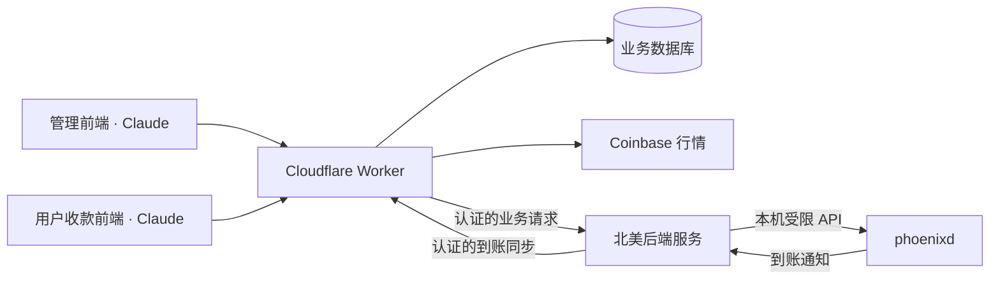

# 多商户收款：第一阶段后端方案

状态：第一阶段后端已实现，等待前端接入和真实环境验收。接口样例见 [后端接入与部署](backend-setup.md)。

后端由 Codex 负责，管理端与用户端前端由 Claude 负责。现有本地 demo 保留，不能直接作为生产收款后端。

## 1. 已确认的业务范围

| 项目     | 第一阶段规则                                                                                |
| -------- | ------------------------------------------------------------------------------------------- |
| 资金模式 | 平台控制一个 phoenixd 钱包，统一收款，按商户记账                                            |
| 商户     | 平台管理员创建、查看、停用；没有商户账号、自助注册或商户管理端                              |
| 收款链接 | `/onne` 中的 `onne` 就是 merchant ID；创建后不可改，不可分配给其他商户                      |
| 金额     | 前端固定预设按钮并允许自定义；后端统一校验 USD 10.00–300.00，最多两位小数，无商户级金额配置 |
| 预设按钮 | $10、15、20、25、50、75、100、150、200、250、300，由 Claude 在前端实现                      |
| 付款入口 | 对标参考页，面向 Cash App 展示 Lightning 二维码、复制 invoice、Pay Now 按钮                 |
| 付款来源 | 不通过标准 Lightning 收款声称已验证付款钱包品牌，不拒收其他兼容钱包的有效支付               |
| 付款人   | 无需账号；订单号／备注可选，不要求姓名、手机号、邮箱                                        |
| 报价     | Coinbase BTC/USD 现货参考价，不加汇率差价，最多缓存 60 秒；无有效行情时暂停开票             |
| 换算     | 后端用精确十进制或整数运算计算 USD 对应 sats，向上取整；不能用浮点数直接记账                |
| 有效期   | invoice 有效期 1 小时，创建后 sats 不变；保存原 USD 金额、行情来源和获取时间                |
| 美元含义 | 原始 USD 是创建时报价依据，不承诺 Cash App 付款时美元扣款一致，也不承诺美元结算             |
| 商户应收 | 按 sats 记账，暂不收平台手续费；收款侧节点成本由平台承担并单独记录                          |
| 结算     | 管理员在线下转账后登记金额、凭证和对应订单；不提供自动提现或打款接口                        |
| 退款     | 第一阶段完全不实现，包括退款接口、退款登记和退款账务                                        |
| 设计容量 | 至多 100 个商户、每日约 1,000 笔订单、峰值每秒 5 次开票；超载应明确拒绝或等待，不得静默丢单 |

## 2. 部署与职责

### Cloudflare Worker

复用现有后端工程和业务数据库，提供管理 API 与公开收款 API。负责：

- 管理员身份与权限检查；复用已有预开户邮箱 OTP 认证，但普通会话不能自动视为管理员授权。
- 商户生命周期、公开 merchant ID 解析。
- 美元金额校验、行情获取、换算、报价快照。
- 创建与查询订单，执行调用方幂等规则。
- 确认到账后记录商户应收，维护收款与结算查询。
- 主动通过北美服务查询支付事实，并进行去重、核对和持久化。

### 北美后端服务

部署在 phoenixd 所在服务器，位于 `apps/gateway`，使用 Node.js 26 + Effect HttpApi，复用共享契约。它是独立后端应用，具有配置、HTTP 路由和供应商客户端；无数据库或后台同步任务。负责：

- 只接受受认证的 Worker 调用，不接受浏览器直接开票。
- 对外仅开放创建 invoice 与查询付款状态；不做 phoenixd 任意路径透传，不提供转账能力。
- 持有 phoenixd 的 limited-access 密码；完整权限密码和助记词不进入 Worker 或前端。
- 以平台订单号关联 phoenixd invoice，按 payment hash 查询已保存的 invoice。
- 核对订单号、金额及付款事实，向 Worker 返回安全字段；不回调 Worker。

phoenixd 的 9740 端口只允许本机／私有容器网络访问。北美业务入口采用 HTTPS 与服务间认证；具体托管、入口方式及密钥配置在部署步骤中确定，不需要向用户前端开放。

### 数据归属

- 商户、业务订单、报价快照、到账记录及人工结算记录归业务数据库。
- 助记词、通道和钱包数据归 phoenixd 持久化目录。
- 北美 Gateway 无状态；开票结果与查询进度归 Worker 的 PostgreSQL，phoenixd 钱包目录独立持久化。
- 不用钱包总余额推算某商户应收；每笔有效收款必须明确关联订单和商户。

## 3. 订单与异常流程

1. 付款人访问商户链接；后端确认商户存在且启用。
2. 前端提交美元金额、可选备注和本次提交的幂等键。USD 请求以整分传输，例如 $15.00 为 `amountUsdCents: 1500`。
3. Worker 校验输入、取得有效行情、保存订单及固定报价，再请求北美服务创建 invoice。
4. 北美服务绑定订单与 phoenixd invoice，返回 BOLT11、payment hash 和实际到期时间。
5. 用户进入独立订单链接。刷新只查询原订单，不能重新创建 invoice。
6. 后端核验到账后，订单变为已支付；商户应收按本单有效支付的 sats 入账，节点费用另外核算。
7. 管理员查看未结算收款，在线下转账后登记结算记录与凭证。

建议公开支付状态：

| 状态       | 含义和前端行为                                               |
| ---------- | ------------------------------------------------------------ |
| `creating` | 开票中或结果尚待确认；继续查询同一订单，不自动用新幂等键重开 |
| `pending`  | invoice 已创建，等待支付                                     |
| `paid`     | 后端已核实真实到账；展示成功，不由前端跳转或倒计时自行判定   |
| `expired`  | invoice 到期且未确认到账；允许用户主动重新报价创建新订单     |
| `failed`   | 已确定无法完成开票；显示明确错误和重试方式                   |

关键约束：

- 同一幂等键、同一商户和相同请求内容复用同一订单；相同键携带不同内容返回冲突。
- 创建结果尚未保存和展示时，超时允许重试开票，接受遗留未使用 invoice；已保存并展示的 invoice 不得自动替换。
- phoenixd 的 `externalId` 是关联字段，不是它提供的幂等保障；不能只传这个字段就认为不会重复开票。
- 新订单不覆盖旧订单。若最终收到已过期订单的有效到账，仍须更新旧订单并记账；若两个订单都被支付，则分别记录真实收款。
- 付款页倒计时只用于展示。后端根据 invoice 到期时间和实际支付事实确定状态。
- 停用商户阻止新开票；既有订单仍能查询和接收到账更新，不删除历史归属。
- 收款金额、实际净入账和节点费用分别记录；手续费额度不能冒充可结算余额。
- Worker 通过 Gateway 主动查询已保存 payment hash 的到账状态；公开订单查询与每分钟 Cron 补查共同更新业务数据库。
- 先生成固定订单集合与总金额的结算单，占用订单；平台人工付款后提交凭证确认完成，才计入已结算。未付款时可取消释放订单，保留历史明细和审计字段。系统不执行转账，也无法阻止人在外部钱包重复转账。
- 结算按整笔收款登记：一次可以结算同一商户的多笔订单，每笔订单只归属一次结算，暂不拆分一笔订单的结算金额。
- 不做订单／收款／结算的物理删除或直接修改金额来“修账”。

## 4. 给 Claude 的接口

这些接口已在 Worker 实现；共享契约位于 `packages/api/src/payments.ts`。配置数据库与服务凭证后可直接联调；前端同源代理和页面由 Claude 接入。

### 用户收款端

| 接口                                            | 输入／输出及约束                                                                       |
| ----------------------------------------------- | -------------------------------------------------------------------------------------- |
| `GET /api/public/merchants/:merchantId`         | 商户可收款状态、统一币种与金额限制；不返回任何商户账务                                 |
| `POST /api/public/merchants/:merchantId/orders` | 请求：`amountUsdCents`、可选 `reference`，`Idempotency-Key` 请求头；返回新建或复用订单 |
| `GET /api/public/orders/:publicOrderId`         | 返回订单支付状态、原始 USD 金额、固定 sats、BOLT11、到期时间、服务器时间及必要错误信息 |

订单使用高熵、不可枚举的公开标识；知道 merchant ID 不足以列出其订单。公开响应只包含付款所需内容，不返回内部备注、成本、结算信息或服务凭证。公开付款链接按持有链接即可查看付款信息设计，不用于展示管理数据。

前端职责：

- 商户入口 `/onne`，订单入口 `/pay/invoice/:publicOrderId`。
- 金额按钮、自定义金额和可选订单号／备注；后端仍独立校验。
- 开票期间禁用重复提交；网络重试使用原幂等键。
- 原始 USD 金额、invoice 二维码、复制按钮、剩余时间和支付状态。
- 按参考页生成 Cash App 入口 `https://cash.app/launch/lightning/{invoice}`；此 URL 来自观察到的参考页，真机兼容性需验证。
- 初版通过轮询订单查询获知结果，不由 Cash App 返回页面就判定付款成功。
- 到期后由用户主动重开；后端暂时不可用与“订单未支付”分别展示。

查询间隔、字段可空规则、错误码和 JSON 样例见 [接入文档](backend-setup.md)。基础错误区分输入无效、商户停用、行情不可用、开票结果待确认、服务不可用、请求冲突及限流。

### 平台管理端

| 接口                                           | 用途                                                            |
| ---------------------------------------------- | --------------------------------------------------------------- |
| `POST /api/admin/merchants`                    | 创建 merchant ID                                                |
| `GET /api/admin/merchants`                     | 分页查询商户及状态                                              |
| `PATCH /api/admin/merchants/:merchantId`       | 启用／停用；不改 ID、不配置金额选项                             |
| `GET /api/admin/orders`                        | 按商户、支付状态、时间筛选订单，分页返回                        |
| `GET /api/admin/orders/:orderId`               | 查询订单、报价、收款及结算详情                                  |
| `GET /api/admin/merchants/:merchantId/summary` | 累计实收、已登记结算、未结算应付，均以 sats 表达                |
| `POST /api/admin/settlements`                  | 生成固定订单和金额的待付款结算单；只传 merchantId，支持幂等重试 |
| `GET /api/admin/settlements`                   | 分页查询待付款／已结算／已取消批次                              |

所有管理接口均验证平台管理员权限。公开创建订单不能传入后台状态、行情、sats、结算字段或任意 webhook URL。

## 5. 实施顺序与验收

1. 定稿共享接口契约、状态及错误样例，交给 Claude；不修改他的前端实现。
2. 完成商户、报价、订单和管理权限后端逻辑。
3. 完成北美服务的开票、结果恢复、到账同步及补偿查询。
4. 完成商户应收统计、结算单生成、确认和取消。
5. 使用本地环境联调并完成针对性测试、类型、格式与构建检查。
6. 北美部署与真实 Cash App 付款单独执行：先确定服务器访问方式、服务认证、钱包备份、通道流动性和费用预算，再由用户操作实际付款。

必须覆盖的验收场景：

- 两个商户使用各自链接开票，收款准确归属，不能跨商户串账。
- 金额边界、精度、行情失败与过期缓存得到明确处理。
- 双击、刷新、重复状态查询及服务重启不会重复记账或替换已展示 invoice；未展示的失败创建允许重试。
- 页面关闭后仍可补查到账；已过期订单晚获知到账仍正确记录。
- 商户停用后不能新开票，历史订单仍可确认到账。
- 无管理员权限不能调用管理接口；公开调用不能读取钱包密钥或商户历史账务。
- 结算金额和对应收款一致；重复登记及重复订单归属被拒绝。
- Cash App 真机可打开／扫描 invoice、付款后页面通过后端状态显示成功。

## 6. 明确不做与待部署核对项

不做：商户后台、自助注册、多商户独立钱包、自动提现／打款、退款、平台收费、USD 保值结算、商品目录、发货、复杂角色体系。

实施不依赖立即购买服务器或执行资金交易。生产上线前仍需单独完成：服务器与域名配置、凭证部署、备份恢复演练、实际流动性费用预算、Cash App 账户可用性和真机支付。当前 demo 关闭了自动流动性和手续费额度累积，不能不经调整直接用于真实收款。

## 7. 依据

- 参考页：[金额选择](https://www.kkoodd.com/onne)、会话中提供的 invoice 付款页；只观察界面，没有执行付款。
- [Coinbase 现货价格接口](https://docs.cdp.coinbase.com/coinbase-app/track-apis/prices#get-spot-price)：无需认证，无需配置付费订阅；没有文档保证匿名调用无限额。接口不提供报价生成时间，系统记录的是自身获取时间。
- [Cash App Bitcoin](https://cash.app/bitcoin)、[Cash App 服务条款](https://cash.app/us/en/legal/tos)：Lightning 付款与 USD 换算规则；不据此保证特定账户或地区可用。
- [phoenixd v0.9.3 API](https://github.com/ACINQ/phoenixd/blob/v0.9.3/src/commonMain/kotlin/fr/acinq/phoenixd/Api.kt)：开票、externalId、支付查询与通知。接口本身不提供商户账务或开票幂等保证。

## 结算批次补充（已实现）

每日由管理员操作生成，截止时间由后端取当前快照，界面按北京时间展示；包含往日积累的全部符合条件订单。新订单不改变已生成的单。同一天可生成多批，订单不能同时被两张有效单占用。结算详情、分页明细、confirm 和 cancel 接口，以及新的汇总口径见 [接入文档](backend-setup.md)。旧“传订单 ID 数组登记结算”接口已替换，前端必须使用新契约。
