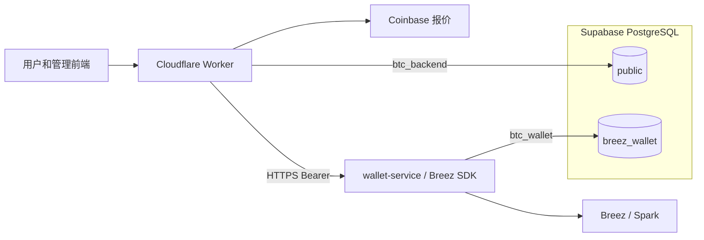

# 多商户收款：第一阶段后端方案

状态：第一阶段后端已实现，等待前端接入和真实环境验收。接口样例见 [后端接入与部署](backend-setup.md)。

后端由 Codex 负责，前端由 Claude 负责。平台管理端与未来商户管理端是两个独立项目，共用同一个 Worker 后端；付款前端无需登录。账号与商户接口详见 [用户管理](user-management.md)。旧节点 demo 已移除。

## 1. 已确认的业务范围

| 项目     | 第一阶段规则                                                                                                                      |
| -------- | --------------------------------------------------------------------------------------------------------------------------------- |
| 资金模式 | 平台控制一个 Spark 钱包，统一收款，按商户记账                                                                                     |
| 商户     | 管理员创建一对一商户账号；第一阶段不开放商户登录和管理端，无自助注册                                                              |
| 收款链接 | `/onne` 中的 `onne` 是独立 slug；内部 merchantId 是 UUID，两者都不可改、不回收                                                    |
| 金额     | 前端固定预设按钮并允许自定义；后端统一校验 USD 1.00–300.00，最多两位小数，无商户级金额配置                                        |
| 预设按钮 | $10、15、20、25、50、75、100、150、200、250、300，由 Claude 在前端实现                                                            |
| 付款入口 | 对标参考页，面向 Cash App 展示 Lightning 二维码、复制 invoice、Pay Now 按钮                                                       |
| 付款来源 | 不通过标准 Lightning 收款声称已验证付款钱包品牌，不拒收其他兼容钱包的有效支付                                                     |
| 付款人   | 无需账号；订单号／备注可选，不要求姓名、手机号、邮箱                                                                              |
| 报价     | Coinbase BTC/USD 现货参考价，不加汇率差价；Cron 每 5 分钟入库，下单用不超过 10 分钟的入库报价，否则实时获取；无有效行情时暂停开票 |
| 换算     | 后端用精确十进制或整数运算计算 USD 对应 sats，向上取整；不能用浮点数直接记账                                                      |
| 有效期   | invoice 有效期 1 小时，创建后 sats 不变；保存原 USD 金额、行情来源和获取时间                                                      |
| 美元含义 | 原始 USD 是创建时报价依据，不承诺 Cash App 付款时美元扣款一致，也不承诺美元结算                                                   |
| 商户应收 | 按 sats 记账，暂不收平台手续费；不建模收款手续费；钱包实收单独核验                                                                |
| 结算     | 先生成固定结算单，再在结算单上用 USDC/USDT 打款，打款完成即结算；不提供独立提现                                                   |
| 退款     | 第一阶段完全不实现，包括退款接口、退款登记和退款账务                                                                              |
| 设计容量 | 至多 100 个商户、每日约 1,000 笔订单、峰值每秒 5 次开票；准入为每商户每秒 5 张、全平台每秒 10 张，超载明确返回 429，不得静默丢单  |

## 2. 架构与数据流

Worker 负责商户、订单、幂等、报价、到账入账和结算打款。钱包服务管理一个平台 Spark 钱包，负责固定金额的一小时 BOLT11、支付事实核验和 SDK 生命周期。没有商户独立钱包，没有钱包回调 Worker，没有 webhook。打款只能由管理员在结算单上发起，钱包服务负责跨链报价和发送。

订单创建时固定 sats，先在数据库里为该幂等键占位并通过准入检查，再向钱包开票，成功后把 invoice 写入订单；开票失败删除占位，不留订单。只有带 invoice 的订单才向用户展示。到账以钱包服务查到的 SDK completed 收款为准，核对订单、hash、invoice，到账金额不少于 invoice 金额即入账（多付部分单独记录、不结算给商户），幂等处理。支付 pending 不是业务 paid。Worker 每分钟按游标拉取钱包新完成的收款并入账，付款人关闭页面后也能在约 1 分钟内补记；付款页查询（到期后 10 分钟内）和管理端订单详情也会即时核对。

商户应收等于已支付订单 amountSat。钱包余额不能推算商户余额。费用字段已删除；不通过减费用构造到账金额。结算为生成固定批次 → 系统打款 → 打款完成自动结算，取消仅释放没有进行中打款的批次。详见 [结算单稳定币打款](settlement-payouts-plan.md)。

## 3. 实施与验收

项目为 greenfield，仅维护全新建库 SQL，不保留历史兼容迁移。SDK 管理 `breez_wallet` 中的表，业务迁移管理 `public` 中的表。Breez key、seed 只放钱包服务，Worker 持有有限 HTTP 接口凭证。

API、环境变量、Dokploy 和人工验收见 [后端接入与部署](backend-setup.md)。结算详见 [结算批次](settlement-batches-review.md)。前端由 Claude 负责，公开订单接口仍返回 invoice、金额、到期时间和支付状态。
