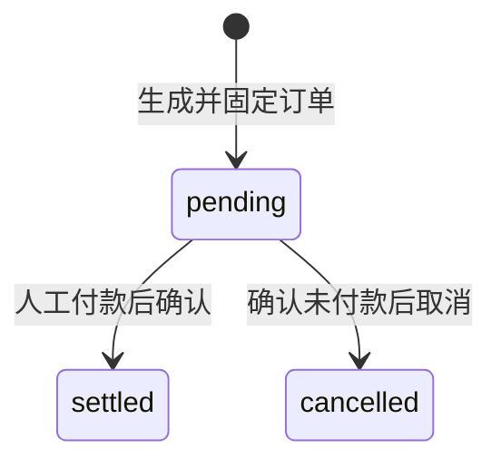

# 商户结算批次方案（已实施）

日期：2026-11-18。状态：后端已实施并在隔离测试数据库验证；未执行远端迁移或转账。实际接口、部署步骤以 [接入文档](backend-setup.md) 为准。

## 1. 已对齐的业务规则

- 平台每天人工为商户结清款项；一次可能包含几千笔订单。
- 展示时区为北京时间 `Asia/Shanghai`，不按午夜自动切账。管理员操作生成时，由后端确定截止时间。
- 先生成结算单，固定订单集合和应付金额；管理员在外部完成转账，再提交凭证确认完成。
- 新订单、新到账不会改变已生成的结算单。
- 范围是该商户截止时已确认到账、未结算、未被其他有效批次占用的全部订单，包含往日积累。
- 同一天允许生成多批；不限制同一商户只能有一张待付款单，但各批订单不得重叠。
- 沿用已确认的 sats 应付口径：每单取 `amountSat`，平台承担的节点费用不从商户应付中扣除。本方案不新增 USD 保值、汇兑、转账手续费扣减或自动付款。

## 2. 管理员操作流程

1. 商户页面展示已支付应付、已结算、待付款批次占用、可生成结算单四个金额，以及尚未确认到账的订单数量。
2. 管理员点击“生成结算单”。前端为此次操作产生一个幂等键，请求只传 `merchantId`。
3. 后端原子生成批次，返回编号、状态、北京时间对应的截止时刻、订单笔数和应付总额。界面预览金额不作为付款依据，以生成成功后的批次为准。
4. 管理员打开结算单核对金额和明细，在线下转账；该步骤不执行数据库事务、不持有数据库锁。
5. 管理员输入转账凭证／流水号，确认“已实际付款”。后端将该批次改为已结算并记录操作者与确认时间。
6. 尚未付款时可填写原因取消；订单释放后可以进入新批次。取消单仍能查看原金额、原订单和取消记录。

例：11 月 18 日 18:35 生成 A 单，固定 2,850 笔、32,000,000 sats。18:36 新确认 10 笔不会加入 A 单。19:00 管理员付款并确认 A 单，19:10 可为剩余订单生成 B 单。

前端由 Claude 实现；本次后端工作只提供接口、契约及接入说明。

## 3. 状态与金额语义



| 状态               | 订单占用         | 是否计入已结算 | 允许操作                 |
| ------------------ | ---------------- | -------------- | ------------------------ |
| `pending` 待付款   | 是               | 否             | 查看、确认、取消         |
| `settled` 已结算   | 是，永久归属     | 是             | 查看；相同确认请求可重试 |
| `cancelled` 已取消 | 否；保留历史明细 | 否             | 查看；相同取消请求可重试 |

已结算不可取消、改金额、改凭证、改订单或删除。已取消不可再确认。第一版不做部分付款、部分结算、部分取消、批次合并或重新打开。

转账结果不明时保留 `pending`，先核实，不取消释放、不再次付款。系统只记录管理员声明，不能验证线下凭证的真实性或阻止管理员在外部钱包重复转账。

商户汇总保留原字段并增加两个字段：

- `paidSat`：所有已确认支付订单的商户应付。
- `settledSat`：归属 `settled` 批次的应付。
- `unsettledSat = paidSat - settledSat`：全部未结清金额，包含待付款批次。
- `pendingSettlementSat`：归属 `pending` 批次的金额。
- `availableSettlementSat = unsettledSat - pendingSettlementSat`：尚未被批次占用的金额。

订单的支付状态仍是 `paid`，不会因结算变成新的支付状态。管理响应增加独立的 `settlementStatus: null | pending | settled`；当前 `settlementId` 表示有效批次归属，不能再把“非空”直接解释成已结算。

## 4. 截止时间与迟到确认

- 不接受前端传截止时间或金额。数据库在取得该商户的结算操作锁后、选取订单时采样 `cutoffAt`，响应返回此时间；它代表本次生成实际执行时刻，不是浏览器本地按钮时间。
- 所有时间存为带时区时间戳，API 返回 UTC ISO8601，前端固定按 `Asia/Shanghai` 展示、筛选日期转换按同一时区处理。
- 选取条件：同商户、支付状态为 `paid`、`paidAt <= cutoffAt`、没有有效批次归属。候选订单以一次数据库查询的可见快照固定，后续不再扫描补入。
- 在该快照中尚未提交的付款确认不进入本批，即使后来获知实际付款时间早于截止时间，也顺延下一批。这里没有“当天起始时间”过滤，顺延不会漏掉往日收款。
- 截止时间、金额、笔数与明细一旦提交即不可修改。取消不会改变这些历史字段。
- 商户被停用不妨碍结算历史收款；停用仅限制新业务订单。

## 5. API

所有接口沿用平台管理员会话、`PAYMENTS_ADMIN_IDS` 白名单、写请求 Origin 检查。Gateway 不参与结算，无需调整。

| 方法与路径                                | 请求                                           | 响应与行为                                            |
| ----------------------------------------- | ---------------------------------------------- | ----------------------------------------------------- |
| `POST /api/admin/settlements`             | `{merchantId}`，必填 `Idempotency-Key`         | 新建返回 201；同键同商户重试返回 200 和原批次当前状态 |
| `GET /api/admin/settlements`              | `merchantId? status? from? to? limit? offset?` | 按创建时间倒序的分页批次；不附带全部订单 ID           |
| `GET /api/admin/settlements/:id`          | 无                                             | 固定金额、笔数、截止时间、状态、审计字段              |
| `GET /api/admin/settlements/:id/orders`   | `limit? offset?`                               | 固定批次的历史订单明细，取消后仍可查询                |
| `POST /api/admin/settlements/:id/confirm` | `{proof}`                                      | 仅 pending 可确认；提交成功返回已结算批次             |
| `POST /api/admin/settlements/:id/cancel`  | `{reason}`                                     | 仅 pending 可取消；提交成功返回已取消批次             |
| `GET /api/admin/merchants/:id/summary`    | 无                                             | 返回第 3 节的金额及未确认到账数量                     |

列表采用 `{items, total, limit, offset}`，默认 50、每页最多 100；分页上限不限制批次总订单数。明细按订单 ID 固定排序；批次列表按 `createdAt DESC, id` 排序。`from` 含、`to` 不含，过滤批次创建时间。

创建请求示例：

```http
POST /api/admin/settlements
Idempotency-Key: 8b562e87-a348-4e04-9705-3c09b4ea7195
Content-Type: application/json

{"merchantId":"onne"}
```

响应示例：

```json
{
  "id": "e737cf7e-e61f-4f02-8104-c09422446545",
  "merchantId": "onne",
  "status": "pending",
  "amountSat": 32000000,
  "orderCount": 2850,
  "cutoffAt": "2026-11-18T10:35:00.000Z",
  "createdAt": "2026-11-18T10:35:00.000Z",
  "createdBy": "admin-user-id",
  "proof": null,
  "confirmedAt": null,
  "confirmedBy": null,
  "cancelReason": null,
  "cancelledAt": null,
  "cancelledBy": null
}
```

确认和取消以批次 ID 为操作对象，不另加幂等键：

- 已 settled + 相同 proof：返回原结果，不修改确认人或时间；不同 proof 返回 409。
- 已 cancelled + 相同 reason：返回原结果，不修改取消人或时间；不同 reason 返回 409。
- confirm 与 cancel 并发时只能一个成功，另一个返回状态冲突。
- proof 为去首尾空白后的 1–1000 字符文本，reason 为 1–500 字符。保留录入值，不在日志输出正文。
- 创建接口严格拒绝旧字段 `orderIds`、`amountSat`、`proof` 及其他未知字段，不能静默忽略旧请求。
- 同一个创建幂等键换商户返回 409；批次已取消后重试旧键仍返回取消单，新建必须换新键。

新增错误码：`NO_ELIGIBLE_ORDERS`（409，无可结算订单，不创建空批次）、`SETTLEMENT_NOT_FOUND`（404）、`SETTLEMENT_STATE_CONFLICT`（409）、`SETTLEMENT_PROOF_CONFLICT`（409）、`SETTLEMENT_REASON_CONFLICT`（409）。输入错误仍为 400，金额溢出为服务错误；数据库锁等待／事务超时为可重试 503，绝不返回部分生成成功。

## 6. 数据设计

扩展现有表，新增一张明细表；复用现有 PostgreSQL，不引入 Gateway 数据库或新消息服务。迁移文件为 0006_slippery_iron_man.sql。

**settlement：批次头**

保留 id、merchantId、幂等键、amountSat、createdBy、createdAt；新增 status、orderCount、cutoffAt、confirmedAt/By、cancelledAt/By、cancelReason。proof 改为可空，确认时必填。

状态约束：pending 无完成／取消字段；settled 必须有 proof 和确认人／时间、无取消字段；cancelled 必须有取消原因和取消人／时间、无确认字段。金额必须为正，笔数必须为正。审计操作者外键禁止删除历史用户记录。

**settlement_item：不可变批次明细**

保存 settlementId、merchantId、orderId、amountSat（该单应付快照）。主键为 `(settlementId, orderId)`。使用 `(merchantId, settlementId)` 和 `(merchantId, orderId)` 复合外键，确保批次和订单属于同一商户；订单表需增加对应复合唯一约束。外键禁止删除历史。

同一订单允许出现在多张历史取消单和最终有效单中，因此不对明细表 orderId 做全局唯一。明细不能因取消而删除，不能因当前订单归属变化而从历史单消失。

**payment_order.settlementId：唯一的当前占用指针**

复用当前字段和同商户复合外键。pending 与 settled 批次都占用它；cancelled 时清空该批次所占指针。批次状态、明细与指针的更新必须在同一事务内完成，不能仅以“明细存在”推断当前占用。

金额计算使用数据库整数聚合／应用 BigInt，不经浮点数。批次金额不复用单笔订单的 Sats 上限，使用与现有结算数据库上限一致的独立 Schema；超出可支持范围时整体拒绝，不截断、不自动拆成多笔转账。

索引：候选订单使用按 merchantId、paidAt、id 的 partial index（paid 且 settlementId 为空）；批次保留商户+创建时间索引；明细主键支持分页，并补足订单侧复合外键索引；确认人／取消人外键增加索引。根据实际查询计划验证是否需要额外状态索引。

权限：新表启用并 FORCE RLS，仅平台管理员事务作用域可访问；延续非所有者、非 BYPASSRLS 的 `btc_backend` 连接。不得通过公开订单接口暴露批次凭证或完整明细。

## 7. 事务、并发与重试

生成流程：

1. 对创建幂等键取得事务级锁，查询已有批次；已有则验证商户后返回。
2. 对该商户取得结算操作专用事务级锁；生成、确认、取消统一遵循“商户锁 → 批次／订单锁”的顺序。专用锁不让普通新订单创建依赖结算锁。
3. 采样 cutoffAt，按稳定顺序一次选取并锁定候选订单。不使用 SKIP LOCKED 静默漏选，不逐条向数据库往返。
4. 聚合精确金额和笔数；插入批次和明细，批量设置订单指针。核对写入笔数后提交。
5. 外部转账、phoenixd 查询均不在该事务中。

确认：先取得商户锁，再锁定批次；检查状态及幂等重试，原子写入 settled 和确认审计字段。无需再次更新几千笔订单；其指针仍指向该批次，汇总按批次状态计算。

取消：以同样顺序锁定商户和批次，核对 pending；只清空仍指向该批次的订单指针，并原子记录 cancelled。保留批次与明细。

同商户不同键并发生成会串行选取互不重叠的订单；若第二次无剩余订单则返回 NO_ELIGIBLE_ORDERS。不同商户可并行。数据库异常整体回滚；响应丢失后用原键或原确认内容重试，不能生成新批次代替核实结果。

## 8. 几千笔订单的容量与到账延迟

第一版用同步事务生成批次，按 5,000／10,000 笔做真实 PostgreSQL 验证；这些是测试规模，不是新的产品上限。不引入异步批次状态或排队系统，除非实际测试证明单次请求不能稳定完成。

实现使用 5 秒锁等待和 15 秒单条 SQL 时限；超时回滚后提示重试，不把前 100 笔作为完整结算单。记录生成耗时、订单笔数和错误分类。

当前恢复任务每分钟最多处理 50 笔。若有 5,000 笔待补查，仅遍历一轮理论上至少约 100 分钟，慢请求或失败还会增加延迟；已过期未支付订单也可能占据扫描名额。因此本方案不承诺“点击时已收到的每一笔钱都立即可结算”。

第一版生成批次只使用已确认到账的数据库事实，不同步扫描几千个 invoice。商户页面明确展示未确认到账数量（非实际已付款数量），有疑问先等待或核对再生成。到账补查吞吐和过期订单调度需作为上线前配套验证项；若不能满足实际峰值，另行调整批量／并发及冷热查询频率，不能只提高结算上限后声称支持几千单日结。

## 9. 旧数据与接口迁移

现有记录表示已完成的线下转账，全部迁为 settled，不得迁为 pending：

- 保留原批次 ID、金额、凭证、创建人、创建时间。
- confirmedBy/At 使用原 createdBy/At，含义为历史登记人／时间，不声称它是实际转账发生时刻。
- 根据现有订单指针生成历史明细和 orderCount，核对所有批次的金额与订单之和。发现空单、缺失订单或不匹配先报告并停止切换，不自动“修账”。
- 历史 cutoffAt 置 null，前端标注“历史记录，无截止快照”，不伪造截止时间。新接口生成的批次必须有 cutoffAt。
- 保留原指针，不重分配已结算订单，不修改现有已发布迁移文件。

本次新增 0006 迁移，在一个事务内扩展字段、回填核对和创建索引；设置 lock_timeout=5s、statement_timeout=60s。该初期迁移需要维护窗口，不是零停机方案。若已有大表，必须先在副本测量并拆分在线索引／分批回填步骤，不能直接执行本次一次性迁移。

切换时暂停管理端结算写操作并等待旧请求结束，完成最后回填／核对，再一起发布新 Worker 和管理前端；迁移会持有表锁，可能让支付写入等待，需安排维护窗口。旧创建字段被拒绝，旧数组列表响应改为分页对象，Claude 必须同步更新消费者。

新批次投入使用后不能直接回退旧代码：旧代码会把非空 settlementId 当成已结算。回退需停结算写入并制定数据兼容方案，优先前向修复，禁止用旧备份覆盖新付款记录。

## 10. 实施范围与验收

改动位置：`packages/api/src/payments.ts` 的 DTO／错误码／路由；`packages/db/src/payments.ts`、新增迁移与角色授权；Worker 的 payments store、rules、service、projection、app；管理汇总和测试；接入文档。用户收款前端、Gateway、phoenixd、自动转账不在本次实现范围。

验收必须覆盖：

1. 5,000／10,000 笔完整纳入单批，总额精确，接口不接收订单 ID 列表；分页返回全部固定明细。
2. 待付款时新增订单和新增到账不改变原批次；往日未结算单可纳入。
3. 生成只增加占用金额，确认才增加 settledSat；取消释放占用，历史明细仍可见。
4. 同键重复生成返回原批次，不同商户同键冲突；取消后旧键不生成新单。
5. 真实多连接并发生成不重复占单；确认与取消只有一个成功；重复确认不改凭证及审计字段。
6. 事务中断／超时不留半成品；提交成功响应丢失可安全重试。
7. 迟到确认顺延，不漏入未来批次；北京时间展示、跨日操作与 UTC 存储一致。
8. 已结算不可取消；取消后再入新批次，旧批次明细仍完整；商户停用后可结算历史收款。
9. 使用非所有者、非 BYPASSRLS 连接证明商户隔离，跨商户复合外键拒绝写入；普通用户和公开接口不能访问结算。
10. 从旧迁移和带历史结算的数据升级，金额／归属无变化；旧请求明确拒绝。
11. 回归公开下单、付款确认、管理员权限与原有金额规则；运行 pnpm ready。

## 11. 本次评审重点

已确认的规则：人工生成后再付款的流程；生成时全部纳入可结算订单、不手选／拆单；同商户允许多张互不重叠的待付款单；转账不确定时保留待付款；取消保留历史明细；未赶上的付款确认顺延下一批。

后端已包含批次生命周期、旧记录迁移、并发与 5,000／10,000 笔真实 PostgreSQL 测试。前端由 Claude 接入；远端部署和实际转账仍需单独执行。
