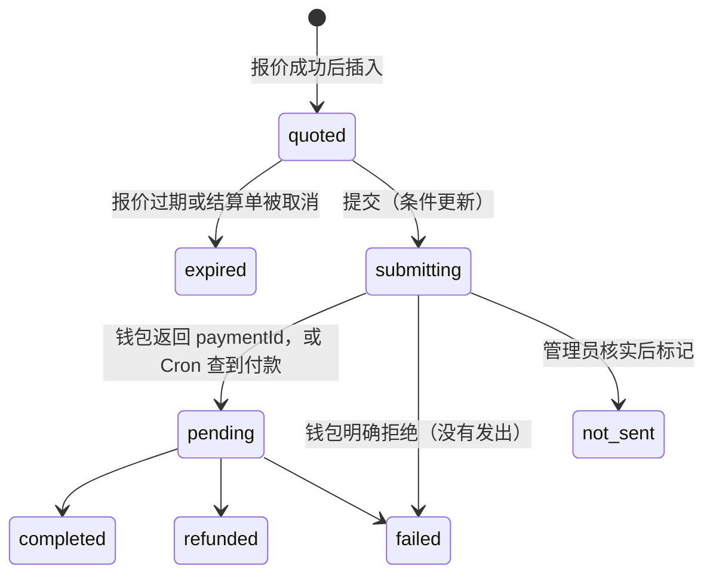

# 结算单稳定币打款方案

日期：2026-11-21。状态：已实施，尚未做主网打款验收。本方案取代此前的“平台钱包提款”方案。接口以 [接入文档](backend-setup.md) 为准。

## 1. 原则与范围

钱包里的每一笔转出都必须属于一张结算单。不提供独立的提款功能，也不再支持“线下付款 + 填凭证”的手动确认。这样，钱包的转出记录和结算记录始终一一对应。

- 管理员在待付款的结算单上发起打款：通过 Breez SDK 的跨链路由，把结算单的 sats 换成 USDC 或 USDT，发到商户的地址。服务商由 SDK 提供（Orchestra / Boltz）。
- 网络以 SDK 运行时返回的路由为准，按文档涵盖 EVM 各链、Solana 和 Tron。资金一律从 BTC 余额里出，不开启稳定余额（USDB）。
- 商户资料里不保存收款方式。每次打款都由平台选择币种和网络，并手动填写地址。
- 一张结算单一次付清，不做部分打款。
- 手续费由商户承担：钱包转出的总额正好等于结算单金额，商户实际收到的稳定币已扣除手续费。
- 多付的部分（`excessMsat`）留在钱包里，第一版没有转出途径，以后单独设计“平台收入提取”。
- 停用的商户仍然可以为历史收款打款结算。

## 2. 管理员操作

入口在结算单详情页，只有待付款、并且没有进行中打款的结算单才显示“打款”按钮。

1. 选择币种（USDT / USDC），再选择网络。网络按常用程度排序（Tron、Ethereum、Solana、BSC、Base、Arbitrum、Polygon，其余按字母排序）；暂时不可用的路由不显示。
2. 填写收款地址。重新打款时，自动带上上一次的币种、网络和地址。
3. 金额固定为结算单金额，不能修改。对话框里显示钱包余额，以及该路由的最小值和最大值（sats 和约合美元两种口径）。余额不足或超出范围时，直接报错，不请求报价。
4. 获取报价：用大字号突出显示“网络 · 币种”和完整地址，下面列出折算价值、手续费、预计到账（都以目标稳定币计）、服务商和过期倒计时。报价有效期约 2 分钟。
5. 提交后，结算单详情页的打款时间线自动刷新，直到打款进入终态。

固定规则：滑点 1%；有多个服务商时，自动选预计到账最多的那个。

## 3. 状态

### 打款（`settlement_payout`）

| 状态         | 中文                | 说明                                                                 |
| ------------ | ------------------- | -------------------------------------------------------------------- |
| `quoted`     | 已报价              | 可以提交                                                             |
| `expired`    | 已过期              | 可以重新报价                                                         |
| `submitting` | 提交中 / 结果待确认 | 提交超过 30 秒后，接口返回显示状态“结果待确认”，不能重新提交         |
| `pending`    | 处理中              | Spark 已转出，跨链服务商正在处理；SDK 的 `refundNeeded` 也归入这一类 |
| `completed`  | 已完成              | 有实收金额；服务商为 Orchestra 时还有目标链交易哈希                  |
| `refunded`   | 已退款              | 钱已退回钱包                                                         |
| `failed`     | 失败                | 确定没有发出，或者服务商报告失败、且没有待处理的退款                 |
| `not_sent`   | 未发出              | 管理员人工核实后标记，必须填写原因，不能撤销                         |

“结果待确认”根据状态和提交时间推算，不单独存标记字段。钱包里找不到对应付款时，**不会自动判为失败**，以免管理员误以为可以重新打款，导致重复转账。如果实现时确认 SDK 在发送时会立即写入带服务商引用的付款记录，可以改为自动判定失败。

### 结算单与打款联动

- 结算单仍然只有 `pending`、`settled`、`cancelled` 三种状态，表上的约束不变。
- “活跃打款”指状态为 `submitting` 或 `pending` 的打款记录。一张结算单最多有一笔活跃打款，也最多有一笔 `quoted`，由部分唯一索引保证。
- 待付款的结算单有活跃打款时，接口返回显示状态“打款中”；如果这笔打款处于“结果待确认”，就返回“结果待确认”。
- 打款进入 `completed` 时，在同一个事务里把结算单改为 `settled`：`proof` 填目标链交易哈希（服务商为 Boltz 时填付款 ID），`confirmed_by` 填提交人。
- 打款结果为 `failed`、`refunded` 或 `not_sent` 时，结算单保持 `pending`，可以重新打款。
- 有活跃打款时不能取消结算单。只有 `quoted` 时可以取消，这份报价会随之改为 `expired`。
- 删除手动确认接口 `POST /api/admin/settlements/:id/confirm`。已经手动确认过的历史结算单保持原样；目前还处于待付款的结算单，只能通过打款完成，或者取消。

## 4. 钱包服务（`apps/wallet`）

- `openWallet` 设置 `crossChainConfig = { defaultSlippageBps: 100 }`。不设置时，所有跨链调用都会失败。收款核对本来就排除带转换信息的付款，不受影响。
- 新增接口：

| 接口                      | 行为                                                                                                                                                                                                                                           |
| ------------------------- | ---------------------------------------------------------------------------------------------------------------------------------------------------------------------------------------------------------------------------------------------- |
| `GET /v1/balance`         | 返回 `balanceSats`                                                                                                                                                                                                                             |
| `GET /v1/payouts/routes`  | 分别用 EVM、Solana、Tron 的占位地址调用 `getCrossChainRoutes`，只保留 USDC/USDT 且接受 BTC 的路由，合并后在内存中缓存 10 分钟。占位地址查路由已验证可行；占位地址不能用于报价                                                                  |
| `POST /v1/payouts/quote`  | 入参 `{ payoutId, chain, asset, address, amountSat }`。用 `parse` 校验地址类型与网络一致，再用实际地址查路由，逐条调用 `prepareSendPayment`（`feePolicy: "feesIncluded"`），取预计到账最多的一条。报价存在内存中，按 `payoutId` 索引，到期失效 |
| `POST /v1/payouts/send`   | 入参 `{ payoutId }`，`idempotencyKey` 设为 `payoutId`。明确的拒绝（报价过期、余额不足、金额越界）返回 4xx；超时和其他错误由 Worker 按结果不明处理                                                                                              |
| `POST /v1/payouts/status` | 入参 `{ payoutId, paymentId }`，按付款 ID 查找，没有时按打款 ID 查找（发送时它是幂等键，SDK 用它作付款 ID），返回状态、实收金额、目标链交易哈希；找不到时返回 `missing`。状态为 `refundNeeded` 时调用 `refundPendingConversions()`             |

2026-11-21 用空钱包在主网验证（只报价，未发送）：

- 占位地址能查到路由：EVM 19 条、Solana 2 条（USDC、USDT）、Tron 1 条（USDT），当时全部来自 Orchestra。代币合约地址和销毁地址不能用于报价，服务商会直接拒绝。
- `feesIncluded` 可用：`amountIn` 等于传入的 sats。手续费 `feeAmount` 和服务费 `serviceFeeAmount` 以目标稳定币的最小单位计价，并且满足 `estimatedOut + feeAmount = assetAmountIn`。例如 100,000 sats 打到 Solana USDT：`assetAmountIn` 为 57.886950，`feeAmount` 为 0.296950，`estimatedOut` 为 57.590000。
- 报价有效期约 2 分钟。
- `prepareSendPayment` 不检查余额，空钱包也能报价。钱包服务需要在报价前自己比对 `balanceSats`；余额不足会在 `sendPayment` 时失败，这种失败按“确定没有发出”处理。
- BTC 来源的限额：最小 1,200 sats，同时不低于 $0.80（Tron 为 $5），最大 $144,100。

报价只保存在内存里，钱包服务重启后需要重新报价。钱包服务继续单副本运行。

## 5. Worker 与数据库

新表 `settlement_payout`，参照 `settlement` 表，用 check 约束固定每个状态允许的字段组合，开启 RLS，使用 `payment_admin` 策略：

| 字段                                                                                     | 说明                                                    |
| ---------------------------------------------------------------------------------------- | ------------------------------------------------------- |
| `id`                                                                                     | UUID，同时作为钱包幂等键                                |
| `settlement_id`、`merchant_id`                                                           | 所属结算单，复合外键引用 `settlement (merchant_id, id)` |
| `amount_sat`                                                                             | 等于结算单金额，由服务端复制，不接受前端传入            |
| `chain`、`chain_id`、`asset`、`asset_contract`、`asset_decimals`                         | 网络与资产快照，小数位以路由为准（BNB 链为 18 位）      |
| `address`                                                                                | 收款地址                                                |
| `provider`、`provider_ref`、`quote_expires_at`                                           | 报价引用                                                |
| `value_out`、`fee_out`、`estimated_out`                                                  | 折算价值、手续费、预计到账，目标资产以最小单位整数保存  |
| `status`                                                                                 | 见第 3 节                                               |
| `payment_id`、`delivered_out`、`external_tx`                                             | 提交后和终态时填写                                      |
| `not_sent_reason`                                                                        | 状态为 `not_sent` 时必填                                |
| `created_by`、`created_at`、`submitted_by`、`submitted_at`、`resolved_by`、`resolved_at` | 操作者与时间                                            |

流程（所有修改结算单或打款记录的事务，都先取得该商户的结算锁，沿用 `lockMerchant`）：

- **报价**：加锁并校验结算单处于 `pending`、没有活跃打款，再把已有的 `quoted` 记录改为 `expired`；提交事务。然后在事务外调用钱包 `quote`，成功后插入一条 `quoted`，插入前重新校验结算单状态。
- **提交**：在事务里执行条件更新 `quoted → submitting`，条件是报价未过期、结算单仍为 `pending`，同时写入提交人和提交时间。然后在事务外调用钱包 `send`，再写回结果：拿到 `paymentId` 改为 `pending`；明确拒绝改为 `failed`；结果不明则保持 `submitting`，并返回 `outcomeUnknown`。
- **完成**：打款改为 `completed` 时，在同一个事务里结算结算单（见第 3 节）。
- **Cron `sync_payouts`**（每分钟一次，每条记录单独处理）：把过期的 `quoted` 改为 `expired`；`pending` 用 `paymentId` 查询；`submitting` 按打款 ID 查找付款，找到后改为 `pending`，找不到则不变。
- 打开结算单详情时，会向钱包核对一次活跃打款。

管理接口（`adminPayments` 组）：

| 接口                                                         | 用途                                                                |
| ------------------------------------------------------------ | ------------------------------------------------------------------- |
| `GET /api/admin/wallet`                                      | 钱包余额                                                            |
| `GET /api/admin/quote`                                       | 当前 BTC/USD 价格与报价时间（读 `btc_quote`），供各处“按当前价”换算 |
| `GET /api/admin/payouts/routes`                              | 币种与网络列表、限额                                                |
| `POST /api/admin/settlements/:id/payouts`                    | `{ chain, asset, address }`，返回报价                               |
| `POST /api/admin/settlements/:id/payouts/:payoutId/submit`   | 提交                                                                |
| `POST /api/admin/settlements/:id/payouts/:payoutId/not-sent` | `{ reason }`，只能用于“结果待确认”                                  |
| `GET /api/admin/settlements/:id`                             | 增加打款显示状态和全部打款记录                                      |
| `GET /api/admin/settlements`                                 | 列表增加打款显示状态                                                |
| ~~`POST /api/admin/settlements/:id/confirm`~~                | 删除                                                                |

新增错误码：`AMOUNT_OUT_OF_RANGE`、`ROUTE_UNAVAILABLE`、`ADDRESS_NETWORK_MISMATCH`、`INSUFFICIENT_BALANCE`、`QUOTE_EXPIRED`、`PAYOUT_IN_PROGRESS`；结果不明时返回 `outcomeUnknown`。

## 6. 管理端（`apps/frontend`）

- 首页改为概览页，显示钱包余额卡片，不设提款入口。
- 删除独立的提款列表页和详情页。
- 结算单列表：状态列使用后端返回的显示状态（待付款 / 打款中 / 结果待确认 / 已结算 / 已取消）。
- 结算单详情：
  - 去掉“确认付款”和凭证输入，改为“打款”按钮和打款对话框（见第 2 节）。
  - 新增打款记录区域：每次尝试都有时间线；常见链显示区块浏览器链接，其他链只显示交易哈希并可复制。
  - “结果待确认”时提供“标记为未发出”。
- 美元：打款记录只显示 sats 和稳定币金额；结算单待付款时按当前价显示约合美元，已结算和已取消只显示 sats。

## 7. 实施顺序

1. 钱包服务：实现接口和模拟 SDK 测试（占位地址查路由、`feesIncluded` 已验证）。
2. 契约、数据库迁移、Worker（报价、提交、完成联动、Cron、删除手动确认），以及测试。
3. 管理端页面，按设计稿实现。
4. 更新 `backend-setup.md`、`settlement-batches-review.md`、`deployment.md`。
5. 主网小额验收：建一个测试商户，生成一张最小金额的结算单，由人工提交打款，然后核对目标链浏览器、钱包余额和结算单状态。
